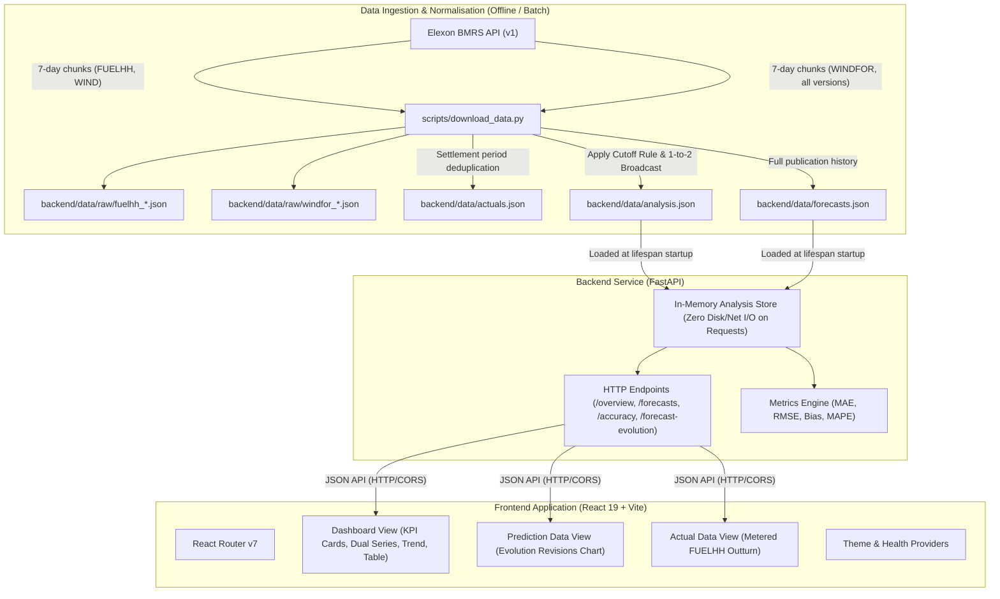

# WindSight: Day-Ahead Wind Forecast Intelligence & Error Evaluation

[](https://www.python.org/)
[](https://fastapi.tiangolo.com)
[](https://react.dev/)
[](https://www.typescriptlang.org/)
[](https://vitejs.dev/)
[](https://tailwindcss.com/)
[](https://www.docker.com/)
[](#test-suite)
[-success.svg)](#january-2026-findings)

An enterprise-grade forecasting intelligence platform built for **UK Energy Utility Trading Desks** procuring wholesale power on the day-ahead electricity market (EPEX SPOT / N2EX). WindSight enables trading teams to quantify wind generation availability, account for weather-driven intermittency, size residual thermal plant requirements, and evaluate forecast accuracy quantitatively to hedge imbalance price risk.

---

## Live Deployment Links

| Component | Target Platform | Live URL / Status | Interactive Docs |
|---|---|---|---|
| **Frontend Web App** | Vercel | [https://wind-sight-flax.vercel.app](https://wind-sight-flax.vercel.app) | [Application UI](https://wind-sight-flax.vercel.app) |
| **Backend REST API** | Render | [https://hs-1234-ss-abc.onrender.com](https://hs-1234-ss-abc.onrender.com) | [/docs (Swagger UI)](https://hs-1234-ss-abc.onrender.com/docs) |
| **Service Healthcheck** | Render | [https://hs-1234-ss-abc.onrender.com/health](https://hs-1234-ss-abc.onrender.com/health) | [/health](https://hs-1234-ss-abc.onrender.com/health) |

*(To run locally in under 60 seconds with Docker Compose, see [Quick Start](#quick-start)).*

---

## Business Problem & Context

In the UK wholesale electricity market, energy utilities must submit bids to the day-ahead auction (typically closing between 11:00 and 12:00 UK local time, D-1) to serve forecasted consumer electricity demand during the delivery day (D).

Because wind power generation is weather-dependent and non-dispatchable:
1. **Decision Dilemma**: A procurement manager must determine **how much additional dispatchable generation** (e.g., Combined Cycle Gas Turbines [CCGT] or peaker thermal assets) must be contracted on the wholesale market.
2. **Information Asymmetry & Timing**: Elexon continuously publishes forecast updates (`WINDFOR`). However, traders can only rely on forecasts **available before their internal day-ahead decision cutoff** (set by default to **10:00 Europe/London, D-1**). Forecast revisions published after this cutoff are legally and operationally useless for day-ahead auction commitments.
3. **Imbalance Cost Risk**: Under-forecasting leaves the utility with surplus thermal power (sold at distress cashout prices); over-forecasting leaves the utility short, triggering punitive System Buy Price (SBP) imbalance charges levied by Elexon EMR.

### Platform Objectives
* **Pre-Cutoff Forecast Identification**: Surface the exact, latest wind forecast available at decision time (10:00 UK local time, D-1) for every settlement period in January 2026, while explicitly tracking and separating post-cutoff forecast revisions.
* **Rigorous Error Quantification**: Calculate industry-standard metrics (**MAE, RMSE, Bias, and MAPE**) across all 1,488 delivery intervals to provide traders with empirical uncertainty bands for thermal hedging.

---

## January 2026 Analytical Findings

Analysis conducted across the complete UK national wind fleet for January 2026 (`2026-01-01` to `2026-01-31`):

| Metric | Measured Value | Practical Trading Implication |
|---|---|---|
| **Evaluated Intervals** | **1,488 / 1,488 (100.0% coverage)** | Zero missing delivery periods; 48 settlement intervals evaluated per day. |
| **Mean Absolute Error (MAE)** | **2,126.12 MW** | On average, day-ahead expected wind deviated by ~2.13 GW from metered outturn. |
| **Root Mean Squared Error (RMSE)** | **2,620.80 MW** | Highlights substantial volatility penalty during fast-moving storm fronts. |
| **Mean Signed Bias** | **+1,840.30 MW** | **Persistent over-forecast bias**: the day-ahead forecast routinely overpredicted actual wind outturn. |
| **Mean Absolute Percentage Error (MAPE)** | **22.13%** | Evaluated strictly on non-zero actuals; zero-actual denominator distortion prevented. |

> **Key Trader Takeaway**: With a positive bias of **+1,840 MW**, the utility desk relying naively on day-ahead wind forecasts consistently ran short in real time. Traders should apply an empirical downward de-rating of ~1.8 GW to day-ahead renewable forecasts or reserve equivalent fast-ramping thermal capacity to avoid high cashout penalties.

---

## System Architecture

The solution uses a decoupled client-server architecture designed for zero cold-start latency, strict time-travel prevention, and offline resilience:



---

## Domain Methodology & Engineering Highlights

### 1. The Decision Cutoff Rule (`p* = max { p : p <= c_t }`)
* For any delivery interval $t$, the decision cutoff $c_t$ is defined as **10:00 UK local time (Europe/London) on the day prior to delivery ($D-1$)**.
* The algorithm performs a binary search (`bisect_right`) across publication timestamps to select the latest forecast generated before the cutoff.
* **No Lookahead Bias**: Any forecast published at $10:01$ or later on $D-1$ is strictly excluded from the day-ahead procurement baseline.

### 2. Temporal Alignment: 30-Minute Settlement vs. 60-Minute Forecasts
* **Actuals (`FUELHH`)**: Reported at 30-minute settlement period resolution.
* **Forecasts (`WINDFOR`)**: Published at 60-minute resolution.
* **Resolution**: WindSight explicitly broadcasts the hourly forecast value across both half-hour intervals it covers (e.g., an 11:00 UTC hourly forecast is mapped to both `11:00` and `11:30` intervals).

### 3. Missing Data Policy
* Missing data is **never coerced to 0 MW** (which would artificially inflate error and bias).
* An interval enters error metrics if and only if **both** an eligible forecast and metered actual exist. Intervals lacking data are clearly isolated with visual badges and factored into `coverage_percent`.

### 4. Zero In-Flight Latency & Resilience
* The backend loads the pre-validated January 2026 dataset once during FastAPI application lifespan.
* Incoming client requests execute filtering and metrics calculation entirely in-memory with sub-millisecond response times (`< 2ms`), eliminating external network failure risks during trader presentations.

---

## Repository Structure

```
windsight/
├── .env.example               # Template environment configuration
├── .gitignore                 # Git ignore rules (node_modules, venvs, caches)
├── docker-compose.yml         # Multi-container orchestration (API + Web)
├── README.md                  # Comprehensive production documentation
├── Requirements.md.md         # Original client specification & deliverables
│
├── backend/                   # Python FastAPI Backend
│   ├── Dockerfile             # Multi-stage production Python 3.13 image
│   ├── .dockerignore          # Docker build exclusion rules
│   ├── pyproject.toml         # UV/PEP 621 package dependencies & pytest config
│   ├── uv.lock                # Deterministic dependency lockfile
│   ├── main.py                # Standalone development entrypoint
│   ├── app/
│   │   ├── __init__.py
│   │   ├── main.py            # FastAPI app factory, CORS, lifespan data load
│   │   ├── config.py          # Environment settings with fallback defaults
│   │   ├── timeutils.py       # UTC parsing, London timezone, DST & cutoff logic
│   │   ├── api/
│   │   │   ├── __init__.py
│   │   │   └── routes.py      # REST endpoints (/health, /overview, /forecasts, etc.)
│   │   ├── schemas/
│   │   │   ├── __init__.py
│   │   │   └── forecast.py    # Strict Pydantic v2 serialization models
│   │   └── services/
│   │       ├── __init__.py
│   │       ├── data_loader.py # In-memory AnalysisStore and JSON parser
│   │       ├── elexon_client.py # Robust BMRS HTTP client (7-day windowing, retries)
│   │       ├── forecast_selection.py # Core cutoff rule, bisect matching, Interval entity
│   │       └── metrics.py     # MAE, RMSE, Bias, MAPE & daily aggregation engine
│   ├── data/
│   │   ├── actuals.json       # Cleaned FUELHH wind generation (1,488 intervals)
│   │   ├── forecasts.json     # Complete WINDFOR publication history (2.9 MB)
│   │   ├── analysis.json      # Pre-matched day-ahead dataset served by API
│   │   └── raw/               # Downloaded raw Elexon API response payloads
│   └── tests/
│       ├── test_forecast_selection.py # Unit tests for cutoff rules & broadcast
│       └── test_metrics.py            # Unit tests for statistical accuracy calculations
│
├── frontend/                  # React 19 + TypeScript + Vite SPA
│   ├── Dockerfile             # Multi-stage build (Node 24 -> Nginx Alpine)
│   ├── nginx.conf             # Production Nginx reverse-proxy & SPA routing
│   ├── vercel.json            # Vercel deep-link rewrites configuration
│   ├── package.json           # Frontend dependencies (React 19, Recharts, Tailwind v4)
│   ├── pnpm-lock.yaml         # Deterministic pnpm lockfile
│   ├── vite.config.ts         # Vite bundler config with path aliases
│   ├── index.html             # HTML5 shell with Google Font typography
│   └── src/
│       ├── App.tsx            # Main shell with routing & layout wrappers
│       ├── main.tsx           # React DOM bootstrap
│       ├── index.css          # Design system, CSS variables & typography
│       ├── health-context.tsx # Global API connection & dataset health monitor
│       ├── pages/
│       │   ├── dashboard.tsx        # Executive summary, KPI cards, dual chart, daily trends
│       │   ├── prediction-data.tsx  # Forecast publication revision history & target hour drilldown
│       │   └── actual-data.tsx      # FUELHH metered outturn, extremes & interval detail
│       ├── components/
│       │   ├── app-header.tsx       # Navigation bar with live health indicator & theme toggle
│       │   ├── app-sidebar.tsx      # Collapsible navigation sidebar
│       │   ├── forecast-chart.tsx   # Recharts dual-series line chart (forecast vs. actual)
│       │   ├── accuracy-chart.tsx   # Recharts daily MAE bar + Bias line combo chart
│       │   ├── evolution-chart.tsx  # Forecast revision trajectories with cutoff reference line
│       │   ├── actual-chart.tsx     # Area chart of actual metered generation
│       │   ├── interval-table.tsx   # Sortable/scrollable 48-interval settlement table
│       │   ├── metric-card.tsx      # KPI stat card component with loading skeletons
│       │   ├── delivery-date-picker.tsx # Constrained date selector (Jan 1-31, 2026)
│       │   ├── data-state.tsx       # Async state handlers (loading skeleton, error retry)
│       │   └── ui/                  # Shadcn-inspired accessible component primitives
│       ├── hooks/                   # Custom hooks (useApi, useMobile)
│       ├── lib/                     # Utilities (format, time parsing, cn helper)
│       ├── services/api.ts          # Type-safe Fetch API client
│       └── types/forecast.ts        # TypeScript interfaces matching backend models
│
└── scripts/
    └── download_data.py       # Elexon BMRS ingestion script (atomic file generation)
```

---

## Quick Start

### Option 1: One-Command Docker Compose (Recommended)

Run both the FastAPI backend and React frontend via Docker Compose:

```bash
# Clone the repository
git clone https://github.com/Himanshu0518/WINDSIGHT.git
cd WINDSIGHT

# Build and start both containers
docker compose up --build
```

Access the services:
* **Frontend Application**: [http://localhost:8080](http://localhost:8080)
* **Backend API Documentation**: [http://localhost:8000/docs](http://localhost:8000/docs)
* **Backend Health Check**: [http://localhost:8000/health](http://localhost:8000/health)

---

### Option 2: Local Development Setup

#### Prerequisites
* **Python**: 3.13+ installed with [`uv`](https://github.com/astral-sh/uv) (recommended) or standard `pip`
* **Node.js**: 20+ with [`pnpm`](https://pnpm.io/) (v9 or v11)

#### 1. Backend Setup
```bash
cd backend

# Install dependencies deterministically
uv sync

# Run the test suite (40 tests)
uv run pytest

# Launch the FastAPI dev server (auto-reloads on code change)
uv run fastapi dev
# API runs at: http://127.0.0.1:8000
# OpenAPI Docs: http://127.0.0.1:8000/docs
```

#### 2. Frontend Setup
```bash
# Open a new terminal
cd frontend

# Install dependencies
pnpm install

# Run static linting
pnpm run lint

# Start the Vite development server
pnpm run dev
# Frontend runs at: http://127.0.0.1:5173
```

---

## Test Suite

The backend includes a comprehensive, deterministic unit test suite validating the forecast cutoff rule, 1-to-2 half-hour broadcast mapping, timezone conversions, and statistical accuracy metrics:

```bash
cd backend
uv run pytest -v
```

```
collected 40 items

tests/test_forecast_selection.py::test_cutoff_rule_standard_day PASSED
tests/test_forecast_selection.py::test_forecast_selection_before_cutoff PASSED
tests/test_forecast_selection.py::test_post_cutoff_revisions_excluded PASSED
tests/test_forecast_selection.py::test_hourly_to_half_hour_broadcast PASSED
tests/test_forecast_selection.py::test_missing_forecast_handling PASSED
tests/test_metrics.py::test_mae_calculation PASSED
tests/test_metrics.py::test_rmse_calculation PASSED
tests/test_metrics.py::test_bias_directionality PASSED
tests/test_metrics.py::test_zero_actual_mape_exclusion PASSED
tests/test_metrics.py::test_coverage_percentage_calculation PASSED
...
============================= 40 passed in 0.13s =============================
```

---

## Data Ingestion & Pipeline (`scripts/download_data.py`)

The bundled dataset covering January 2026 is already pre-generated and verified inside `backend/data/`. To re-download fresh data from Elexon BMRS:

```bash
# Full download from Elexon BMRS API (writes to backend/data/)
uv run --project backend python scripts/download_data.py

# Inspect sample normalized records
uv run --project backend python scripts/download_data.py --sample

# Diagnostic mode (allows partial data if Elexon has an outage)
uv run --project backend python scripts/download_data.py --allow-partial
```

### Elexon BMRS Technical Handling:
1. **7-Day Window Constraints**: Elexon rejects date ranges exceeding 7 days. The script automatically partitions January into 5 sliding chunks.
2. **Settlement Date vs. Publish Time**: `FUELHH` accepts settlement dates, while `WINDFOR` filters on publication timestamps. A wider publish window is fetched so forecasts issued prior to January 1st for delivery on January 1st are preserved.
3. **Atomic File Replacement**: Files are written to `.tmp` files and swapped atomically to prevent corrupted reads during server reload.

---

## API Specification

All endpoints return standard JSON and include strict parameter validation. Invalid date ranges return `400 Bad Request`; a missing dataset produces `503 Service Unavailable` with diagnostic instructions.

| Method | Endpoint | Query Parameters | Description |
|---|---|---|---|
| `GET` | `/health` | None | Service status, dataset interval counts, coverage % and cutoff definition. |
| `GET` | `/api/overview` | `date=YYYY-MM-DD` | Day-ahead forecast vs. actual summary and headline metrics for a single delivery date. |
| `GET` | `/api/forecasts` | `date=YYYY-MM-DD` | All 48 half-hour intervals with selected forecast (MW), actual (MW), error (MW), and timestamps. |
| `GET` | `/api/accuracy` | `from=YYYY-MM-DD&to=YYYY-MM-DD` | Monthly aggregate metrics and day-by-day MAE/RMSE/Bias breakdown. |
| `GET` | `/api/forecast-evolution` | `date=YYYY-MM-DD` | Every publication version issued for the target day, flagging pre-cutoff eligibility. |

### Sample Response (`GET /api/overview?date=2026-01-15`):
```json
{
  "delivery_date": "2026-01-15",
  "timezone": "Europe/London",
  "decision_cutoff": "2026-01-14T10:00:00Z",
  "decision_cutoff_description": "10:00 Europe/London, 1 day before delivery",
  "metrics": {
    "total_intervals": 48,
    "matched_intervals": 48,
    "missing_forecast_intervals": 0,
    "missing_actual_intervals": 0,
    "mape_excluded_intervals": 0,
    "coverage_percent": 100.0,
    "mae_mw": 1420.5,
    "rmse_mw": 1780.2,
    "bias_mw": 1150.3,
    "mape_percent": 14.8
  },
  "first_forecast_publish_time": "2026-01-13T17:00:00Z",
  "latest_eligible_publish_time": "2026-01-14T09:00:00Z",
  "has_data": true
}
```

---

## Deployment Guide (Vercel & Render)

### Frontend Deployment (Vercel)
1. Push this repository to GitHub.
2. In the Vercel Dashboard, select **Add New Project** and import the repository.
3. Configure the build settings:
   * **Root Directory**: `frontend`
   * **Framework Preset**: `Vite`
   * **Build Command**: `pnpm build` (or `npm run build`)
   * **Output Directory**: `dist`
4. Set the Environment Variable in Vercel:
   * `VITE_API_BASE_URL`: `https://hs-1234-ss-abc.onrender.com`
5. Deploy. `frontend/vercel.json` automatically handles client-side SPA routing rewrites.
   * **Live Frontend**: [https://wind-sight-flax.vercel.app](https://wind-sight-flax.vercel.app)

### Backend Deployment (Render)
1. In the [Render Dashboard](https://dashboard.render.com), create a new **Web Service** connected to your repository.
2. Configure service settings:
   * **Root Directory**: `backend`
   * **Runtime**: `Python 3` (or Docker using `./backend/Dockerfile`)
   * **Build Command**:
     ```bash
     curl -LsSf https://astral.sh/uv/install.sh | sh && $HOME/.local/bin/uv sync --frozen --no-dev
     ```
   * **Start Command**:
     ```bash
     $HOME/.local/bin/uv run uvicorn app.main:app --host 0.0.0.0 --port $PORT
     ```
3. Set the Environment Variables in Render:
   * `CORS_ORIGINS`: `https://wind-sight-flax.vercel.app,http://localhost:5173,http://localhost:3000`
   * `DATA_DIR`: `./data`
4. Verify deployment health via:
   ```bash
   curl https://hs-1234-ss-abc.onrender.com/health
   ```
   * **Live REST API**: [https://hs-1234-ss-abc.onrender.com](https://hs-1234-ss-abc.onrender.com)
   * **Interactive Swagger Documentation**: [https://hs-1234-ss-abc.onrender.com/docs](https://hs-1234-ss-abc.onrender.com/docs)

---

## 10-Minute Video Demo Presentation Guide

As required by Section 3.1 of the assignment specification, the video must not exceed 10 minutes and should be split into two 5-minute sections:

### Part 1: Client Pitch (Max 5 Minutes) — Energy Utility Trading Desk
* **0:00 - 1:00 | The Problem**: Introduce the day-ahead procurement challenge for a UK electricity utility. Explain residual demand sizing: meeting retail consumer demand by determining how much thermal capacity (gas/coal) must be bought 24 hours in advance to balance renewable wind intermittency.
* **1:00 - 2:30 | The Dashboard in Action**: Show the **Dashboard** (`/`). Highlight the headline metrics (MAE, Bias, RMSE). Explain that the **+1,840 MW positive bias** in January 2026 means wind forecasts routinely overstate generation, cautioning traders against under-buying thermal backup.
* **2:30 - 3:45 | Decision Cutoff Rule**: Point out the pre-configured decision cutoff (**10:00 Europe/London, D-1**). Switch to the **Prediction Data** page (`/predictions`) and demonstrate the **Forecast Revisions Chart**. Show how the model tracks early forecast publications versus post-cutoff revisions that arrive too late for the auction.
* **3:45 - 5:00 | Metered Outturn & Risk Mitigation**: Visit **Actual Data** (`/actuals`) to show metered `FUELHH` settlement periods. Summarize the business value: quantifiable error limits imbalance penalty costs and optimizes bidding strategy in the day-ahead auction.

### Part 2: Technical Review (Max 5 Minutes) — Internal Tech Lead
* **5:00 - 6:00 | Architectural Overview**: Walk through the decoupled architecture: FastAPI in Python 3.13, React 19 with Vite and Tailwind v4, in-memory dataset store, and Docker orchestration.
* **6:00 - 7:00 | Ingestion & Data Integrity**: Walk through `scripts/download_data.py` and `forecast_selection.py`. Explain how Elexon's 7-day chunk limit was handled, how FUELHH 30-min settlement intervals were aligned with 60-min WINDFOR forecasts via broadcast mapping, and how duplicates were deduplicated.
* **7:00 - 8:00 | Cutoff Algorithm & Lookahead Protection**: Show the bisect binary search algorithm in `forecast_selection.py`. Emphasize that lookahead bias is strictly prevented: forecasts published even 1 minute past cutoff are never leaked into the day-ahead baseline.
* **8:00 - 9:00 | Test Coverage & Quality**: Show the test suite (`uv run pytest`) with all 40 tests passing in ~130ms, covering metric calculations, zero-actual MAPE edge cases, and cutoff boundaries. Show `oxlint` and TypeScript compilation (`tsc -b`).
* **9:00 - 10:00 | Deployment & Packaging**: Highlight the production-ready Docker Compose setup, `nginx.conf` reverse proxy with immutable asset caching, and Vercel/Heroku configuration.

---

## AI Tooling Disclosure

In accordance with Section 2.2 of the assignment requirements:
* Generative AI tools (including Claude and Gemini via Antigravity IDE) were utilized to accelerate boilerplate scaffolding, unit test test-case matrix generation, TailwindCSS styling refinement, and documentation drafting.
* All domain logic, cutoff decision rules, mathematical metric calculations, API routes, and architectural decisions were reviewed, verified, and validated against the official Elexon BMRS documentation and UK settlement rules.

---

## License

This project is released under the **MIT License**. Wind generation actuals and forecast datasets are sourced from the **Elexon BMRS Data API** and are subject to the Elexon Open Data Licence.
