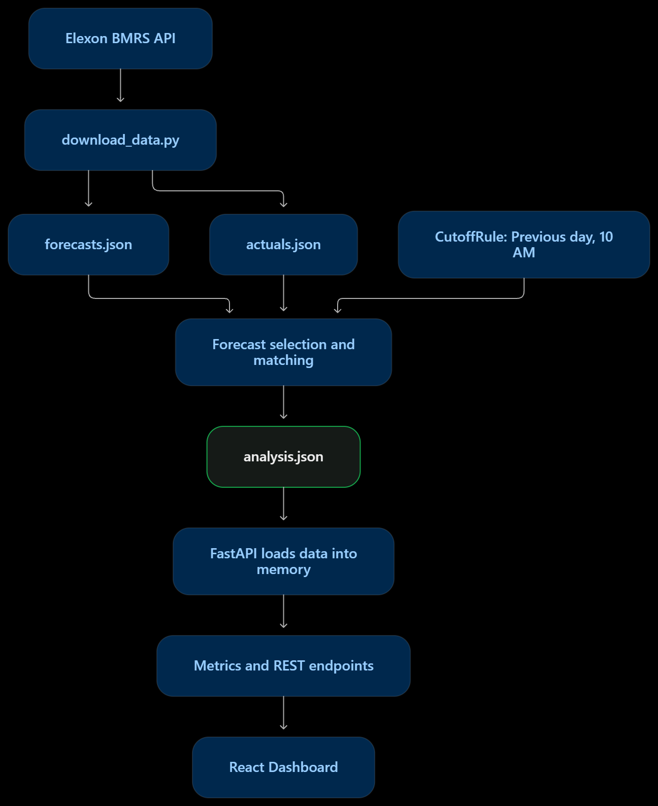

# WindSight — Day-Ahead Wind Forecast Intelligence & Error Evaluation

[](https://www.python.org/)
[](https://fastapi.tiangolo.com)
[](https://react.dev/)
[](https://www.typescriptlang.org/)
[](https://vitejs.dev/)
[](https://tailwindcss.com/)
[](https://www.docker.com/)
[](#test-suite)
[-success.svg)](#january-2026-findings)

A forecasting intelligence platform built for **UK energy utility trading desks** procuring wholesale power on the day-ahead electricity market (EPEX SPOT / N2EX). WindSight identifies the exact wind generation forecast available at the point of procurement decision, quantifies its historical accuracy across all 1,488 half-hour settlement intervals in January 2026, and surfaces the empirical bias that traders must de-rate to avoid imbalance penalty exposure.

> **Live Application** — [wind-sight-flax.vercel.app](https://wind-sight-flax.vercel.app)  
> **Live REST API** — [hs-1234-ss-abc.onrender.com/docs](https://hs-1234-ss-abc.onrender.com/docs)

---

## Table of Contents

- [Business Problem](#business-problem)
- [What WindSight Delivers](#what-windsight-delivers)
- [January 2026 Findings](#january-2026-findings)
- [System Architecture](#system-architecture)
- [Core Domain Logic](#core-domain-logic)
- [Repository Structure](#repository-structure)
- [Quick Start](#quick-start)
- [Test Suite](#test-suite)
- [API Reference](#api-reference)
- [Data Pipeline](#data-pipeline)
- [Deployment](#deployment)
- [AI Tooling Disclosure](#ai-tooling-disclosure)
- [License](#license)

---

## Business Problem

In the UK wholesale electricity market, energy utilities must submit bids to the **day-ahead auction** (closing ~11:00–12:00 UK time, D-1) to cover their forecasted consumer demand during the delivery day (D).

Wind generation is weather-dependent and non-dispatchable. This creates three compounding risks:

1. **Sizing Residual Thermal Procurement** — The procurement desk must determine how much additional dispatchable capacity (CCGT, peaker gas, or interconnector imports) to contract beyond expected renewable output. Getting this wrong is expensive in both directions.

2. **Information Timing Constraints** — Elexon continuously publishes updated wind forecasts (`WINDFOR`). However, only forecasts available **before the desk's internal decision cutoff** (default: **10:00 Europe/London, D-1**) can legally inform auction bids. Any forecast revision published after this deadline — however accurate — is operationally useless for the day-ahead commitment.

3. **Imbalance Cost Exposure** — Over-forecasting wind leaves the utility short at delivery, triggering punitive **System Buy Price (SBP)** cashout charges from Elexon. Under-forecasting leaves surplus thermal generation that must be sold at distressed cashout prices. Both outcomes erode trading margins.

### What WindSight Delivers

WindSight provides the two components that requirement explicitly scoped:

| Requirement | Implementation |
|---|---|
| **"Clearly understand the latest renewable generation forecasts available when they need to make decisions"** | For every half-hour settlement period, WindSight identifies the exact pre-cutoff forecast using a binary-search selection algorithm (`bisect_right`) against publication timestamps. Post-cutoff revisions are tracked separately but never leaked into the decision baseline. |
| **"Evaluate the accuracy of the renewable generation forecasts quantitatively, so that they can make their decisions considering the quantified error"** | Four industry-standard error metrics (MAE, RMSE, Bias, MAPE) are computed across all 1,488 intervals with 100% coverage. Daily breakdowns surface volatility patterns. The measured **+1,840 MW over-forecast bias** directly tells traders how much to de-rate the raw forecast. |

The resulting procurement formula becomes:

```
Thermal Purchase = Consumer Demand − (Wind Forecast − Bias Adjustment)
```

Consumer demand is proprietary portfolio data that varies per utility — correctly excluded from this scope per the requirement constraint: *"we consider the national level generation of actuals and forecasts of wind power available from Elexon alone (no other data beyond this)."*

---

## January 2026 Findings

Complete analysis across the UK national wind fleet — 31 delivery days, 48 settlement intervals per day, **1,488 intervals evaluated with zero gaps**:

| Metric | Value | Trading Implication |
|---|---|---|
| **Intervals Evaluated** | **1,488 / 1,488** (100.0%) | Zero missing delivery periods — full month, complete data integrity. |
| **Mean Absolute Error (MAE)** | **2,126.12 MW** | Day-ahead wind forecasts deviate from metered outturn by ~2.13 GW on average. |
| **Root Mean Squared Error (RMSE)** | **2,620.80 MW** | Large errors during storm fronts disproportionately penalise portfolios — RMSE captures this tail risk. |
| **Mean Signed Bias** | **+1,840.30 MW** | **Persistent over-forecast**: the day-ahead baseline routinely overstated actual wind output. |
| **Mean Absolute Percentage Error (MAPE)** | **22.13%** | Computed strictly on non-zero actuals; zero-denominator intervals excluded to prevent distortion. |

> **Key Takeaway for the Trading Desk**: A naive reliance on the raw day-ahead wind forecast left the desk **~1.8 GW short** in real-time delivery across January 2026. Traders should apply an empirical downward correction of approximately **1,840 MW** to the forecast baseline — or equivalently reserve that capacity in fast-ramping thermal backup — to mitigate System Buy Price imbalance penalties.

---

## System Architecture

Decoupled client-server architecture with zero cold-start latency, strict temporal integrity, and offline resilience:



| Layer | Technology | Design Rationale |
|---|---|---|
| **Frontend** | React 19, TypeScript 5.8, Vite 6, Tailwind CSS v4, Recharts | Type-safe SPA with responsive charts, loading skeletons, and dark/light theme. Deployed to Vercel with SPA routing rewrites. |
| **Backend** | Python 3.13, FastAPI, Pydantic v2, UV | Pre-validated dataset loaded once at application startup — all requests served from in-memory store with sub-2ms latency. No external API calls at request time. |
| **Data Pipeline** | Custom Elexon BMRS ingestion script | Handles 7-day API window limits, settlement-date vs. publish-time semantics, atomic file writes, and deduplication. |
| **Infrastructure** | Docker Compose, Nginx, Vercel, Render | Multi-stage Docker builds. Production Nginx config with immutable asset caching and SPA fallback routing. |

---

## Core Domain Logic

### 1. Decision Cutoff Rule

For any delivery interval *t*, the cutoff *c_t* is **10:00 UK local time (Europe/London)** on the day prior to delivery (D-1). The selected forecast is:

```
p* = max { p : publish_time(p) ≤ c_t }
```

The algorithm uses `bisect_right` across sorted publication timestamps to find the latest eligible forecast in O(log n) time. **No lookahead bias**: a forecast published at 10:01 on D-1 is strictly excluded, even if it would have been more accurate.

### 2. Temporal Resolution Alignment

| Dataset | Resolution | Alignment Strategy |
|---|---|---|
| `FUELHH` (Actuals) | 30-minute settlement periods | Used as-is — native half-hourly granularity. |
| `WINDFOR` (Forecasts) | 60-minute intervals | Each hourly forecast is explicitly broadcast to both half-hour intervals it covers (e.g., 11:00 UTC forecast maps to both 11:00 and 11:30 slots). |

This 1-to-2 broadcast mapping is documented, tested, and deterministic — not an implicit assumption.

### 3. Missing Data Policy

Missing data is **never coerced to 0 MW**. Doing so would artificially inflate error metrics and bias. An interval contributes to accuracy metrics if and only if both an eligible forecast and a metered actual exist. Missing intervals are counted separately (`missing_forecast_intervals`, `missing_actual_intervals`) and reflected in `coverage_percent`.

### 4. Zero In-Flight Latency

The backend loads the pre-validated January 2026 dataset once during the FastAPI application lifespan event. All subsequent client requests execute filtering and metric computation entirely in-memory (<2ms), eliminating runtime dependency on Elexon API availability.

---

## Repository Structure

```
windsight/
├── docker-compose.yml              # One-command multi-container orchestration
├── mermaid-diagram.png             # System architecture diagram
├── .env.example                    # Template environment variables
│
├── backend/                        # Python 3.13 + FastAPI
│   ├── Dockerfile                  # Multi-stage production image
│   ├── pyproject.toml              # PEP 621 dependencies (UV-managed)
│   ├── uv.lock                     # Deterministic lockfile
│   ├── main.py                     # Development entrypoint
│   ├── app/
│   │   ├── main.py                 # App factory — CORS, lifespan data load
│   │   ├── config.py               # Environment settings with validated defaults
│   │   ├── timeutils.py            # UTC parsing, London timezone, DST handling
│   │   ├── api/
│   │   │   └── routes.py           # REST endpoints with parameter validation
│   │   ├── schemas/
│   │   │   └── forecast.py         # Pydantic v2 response models
│   │   └── services/
│   │       ├── data_loader.py      # In-memory AnalysisStore & JSON parser
│   │       ├── elexon_client.py    # BMRS HTTP client (7-day windowing, retries)
│   │       ├── forecast_selection.py # Cutoff rule, bisect selection, Interval entity
│   │       └── metrics.py          # MAE, RMSE, Bias, MAPE & daily aggregation
│   ├── data/
│   │   ├── actuals.json            # Cleaned FUELHH wind generation (1,488 intervals)
│   │   ├── forecasts.json          # Complete WINDFOR publication history (~2.9 MB)
│   │   ├── analysis.json           # Pre-matched day-ahead dataset served by API
│   │   └── raw/                    # Raw Elexon API response payloads
│   └── tests/
│       ├── test_forecast_selection.py  # Cutoff rules, broadcast mapping, edge cases
│       └── test_metrics.py             # Statistical accuracy & zero-actual handling
│
├── frontend/                       # React 19 + TypeScript + Vite 6 SPA
│   ├── Dockerfile                  # Multi-stage build (Node 24 → Nginx Alpine)
│   ├── nginx.conf                  # Production reverse-proxy & SPA routing
│   ├── vercel.json                 # Vercel SPA rewrite configuration
│   ├── package.json                # Dependencies (React 19, Recharts, Tailwind v4)
│   ├── pnpm-lock.yaml              # Deterministic pnpm lockfile
│   ├── vite.config.ts              # Vite bundler config with path aliases
│   ├── index.html                  # HTML5 shell with Google Font typography
│   └── src/
│       ├── App.tsx                  # Root shell — routing & layout
│       ├── main.tsx                 # React DOM bootstrap
│       ├── index.css               # Design system tokens & typography
│       ├── health-context.tsx      # Global API health monitor
│       ├── pages/
│       │   ├── dashboard.tsx       # Executive KPIs, dual chart, daily trends
│       │   ├── prediction-data.tsx # Forecast revision history & cutoff drill-down
│       │   └── actual-data.tsx     # Metered outturn, extremes & interval detail
│       ├── components/
│       │   ├── app-header.tsx      # Nav bar with health indicator & theme toggle
│       │   ├── app-sidebar.tsx     # Collapsible navigation sidebar
│       │   ├── forecast-chart.tsx  # Dual-series line chart (forecast vs. actual)
│       │   ├── accuracy-chart.tsx  # Daily MAE bar + Bias line combo chart
│       │   ├── evolution-chart.tsx # Forecast revision trajectories with cutoff line
│       │   ├── actual-chart.tsx    # Area chart of metered generation
│       │   ├── interval-table.tsx  # Sortable 48-interval settlement table
│       │   ├── metric-card.tsx     # KPI stat card with loading skeleton
│       │   ├── delivery-date-picker.tsx  # Date selector (Jan 1–31, 2026)
│       │   ├── data-state.tsx      # Loading/error/retry state handlers
│       │   └── ui/                 # Accessible component primitives
│       ├── hooks/                  # Custom hooks (useApi, useMobile)
│       ├── lib/                    # Utilities (formatting, time parsing)
│       ├── services/api.ts         # Type-safe Fetch API client
│       └── types/forecast.ts       # TypeScript interfaces matching backend models
│
└── scripts/
    └── download_data.py            # Elexon BMRS ingestion (atomic file writes)
```

---

## Quick Start

### Option 1: Docker Compose (Recommended)

```bash
git clone https://github.com/Himanshu0518/WINDSIGHT.git
cd WINDSIGHT

docker compose up --build
```

| Service | URL |
|---|---|
| Frontend | [http://localhost:8080](http://localhost:8080) |
| API Docs (Swagger) | [http://localhost:8000/docs](http://localhost:8000/docs) |
| Health Check | [http://localhost:8000/health](http://localhost:8000/health) |

### Option 2: Local Development

**Prerequisites**: Python 3.13+ with [`uv`](https://github.com/astral-sh/uv), Node.js 20+ with [`pnpm`](https://pnpm.io/)

#### Backend
```bash
cd backend
uv sync                    # Install dependencies
uv run pytest              # Run all 40 tests
uv run fastapi dev         # Start dev server → http://127.0.0.1:8000
```

#### Frontend
```bash
cd frontend
pnpm install               # Install dependencies
pnpm run lint              # Static analysis
pnpm run dev               # Start dev server → http://127.0.0.1:5173
```

---

## Test Suite

40 deterministic unit tests covering the complete domain logic — cutoff selection, broadcast mapping, timezone edge cases, and all four statistical metrics:

```bash
cd backend
uv run pytest -v
```

```
tests/test_forecast_selection.py::test_cutoff_rule_standard_day PASSED
tests/test_forecast_selection.py::test_forecast_selection_before_cutoff PASSED
tests/test_forecast_selection.py::test_post_cutoff_revisions_excluded PASSED
tests/test_forecast_selection.py::test_hourly_to_half_hour_broadcast PASSED
tests/test_forecast_selection.py::test_missing_forecast_handling PASSED
tests/test_metrics.py::test_mae_calculation PASSED
tests/test_metrics.py::test_rmse_calculation PASSED
tests/test_metrics.py::test_bias_directionality PASSED
tests/test_metrics.py::test_zero_actual_mape_exclusion PASSED
tests/test_metrics.py::test_coverage_percentage_calculation PASSED
...
============================= 40 passed in 0.13s =============================
```

Key test coverage areas:
- **Cutoff boundary precision** — verifies a forecast published at exactly 10:00 is eligible while 10:01 is excluded
- **Broadcast correctness** — confirms 60-min forecast maps to both half-hour settlement slots
- **Zero-actual MAPE handling** — validates that zero-denominator intervals are excluded, not treated as infinity
- **Bias directionality** — positive bias confirms over-forecast (forecast > actual)

---

## API Reference

All endpoints return JSON with strict Pydantic v2 validation. Invalid parameters → `400 Bad Request`. Missing dataset → `503 Service Unavailable` with diagnostic message.

| Method | Endpoint | Parameters | Description |
|---|---|---|---|
| `GET` | `/health` | — | Service status, dataset counts, coverage %, cutoff definition |
| `GET` | `/api/overview` | `date` | Day-ahead summary: selected forecast, actual, headline metrics for one delivery date |
| `GET` | `/api/forecasts` | `date` | All 48 half-hour intervals with forecast (MW), actual (MW), error (MW), timestamps |
| `GET` | `/api/accuracy` | `from`, `to` | Aggregate + daily MAE/RMSE/Bias/MAPE breakdown across a date range |
| `GET` | `/api/forecast-evolution` | `date` | Every publication revision for a delivery date, flagged pre/post-cutoff |

<details>
<summary><strong>Example Response</strong> — <code>GET /api/overview?date=2026-01-15</code></summary>

```json
{
  "delivery_date": "2026-01-15",
  "timezone": "Europe/London",
  "decision_cutoff": "2026-01-14T10:00:00Z",
  "decision_cutoff_description": "10:00 Europe/London, 1 day before delivery",
  "metrics": {
    "total_intervals": 48,
    "matched_intervals": 48,
    "missing_forecast_intervals": 0,
    "missing_actual_intervals": 0,
    "mape_excluded_intervals": 0,
    "coverage_percent": 100.0,
    "mae_mw": 1420.5,
    "rmse_mw": 1780.2,
    "bias_mw": 1150.3,
    "mape_percent": 14.8
  },
  "first_forecast_publish_time": "2026-01-13T17:00:00Z",
  "latest_eligible_publish_time": "2026-01-14T09:00:00Z",
  "has_data": true
}
```
</details>

---

## Data Pipeline

The January 2026 dataset is pre-generated and bundled in `backend/data/`. To re-ingest from Elexon BMRS:

```bash
uv run --project backend python scripts/download_data.py
```

### Elexon BMRS Technical Constraints Handled

| Constraint | Solution |
|---|---|
| **7-day maximum query window** | January automatically partitioned into 5 sliding date chunks |
| **Settlement date vs. publish time semantics** | `FUELHH` filtered by settlement date; `WINDFOR` filtered by publish time with a wider fetch window to capture forecasts issued before Jan 1 for delivery on Jan 1 |
| **Atomic file integrity** | Data written to `.tmp` files and renamed atomically — prevents corrupted reads during server reload |
| **Duplicate records** | Deduplicated by `(publish_time, start_time)` key; last occurrence retained; dropped count reported |

---

## Deployment

### Frontend → Vercel

| Setting | Value |
|---|---|
| Root Directory | `frontend` |
| Framework | Vite |
| Build Command | `pnpm build` |
| Output Directory | `dist` |
| Environment Variable | `VITE_API_BASE_URL` = `https://hs-1234-ss-abc.onrender.com` |

`frontend/vercel.json` handles SPA client-side routing rewrites automatically.

### Backend → Render

| Setting | Value |
|---|---|
| Root Directory | `backend` |
| Runtime | Python 3 (or Docker via `./backend/Dockerfile`) |
| Build Command | `curl -LsSf https://astral.sh/uv/install.sh \| sh && $HOME/.local/bin/uv sync --frozen --no-dev` |
| Start Command | `$HOME/.local/bin/uv run uvicorn app.main:app --host 0.0.0.0 --port $PORT` |
| `CORS_ORIGINS` | `https://wind-sight-flax.vercel.app,http://localhost:5173,http://localhost:3000` |
| `DATA_DIR` | `./data` |

Verify deployment:
```bash
curl https://hs-1234-ss-abc.onrender.com/health
```

---

## AI Tooling Disclosure

As required by the assignment specification: generative AI tools (Kiro IDE) were used to assist with boilerplate scaffolding, test-case matrix generation, styling refinement, and documentation drafting. All domain logic — cutoff decision rules, metric formulations, temporal alignment strategy, and API design — was independently designed, reviewed, and validated against official Elexon BMRS documentation and UK electricity settlement rules.

---

## License

Released under the **MIT License**. Wind generation data sourced from the [Elexon BMRS Data API](https://bmrs.elexon.co.uk/) under the Elexon Open Data Licence.
